# daily-musiclog

One piece of music a day, kept as a small dataset. Each entry is a YouTube video with its date, title, artist, work and channel;
the newest entry is shown below and on my [GitHub profile](https://github.com/mikbalyilmaz).

## Latest entry

<!-- CHOSEN_TODAY:START -->
<a href="https://www.youtube.com/watch?v=3NFywQdeKSo">
  
</a>

**2026-11-11**: [Sister Rosetta Tharpe - Didn't it rain, children](https://www.youtube.com/watch?v=3NFywQdeKSo) · cerinto
<!-- CHOSEN_TODAY:END -->

<!-- STATS:START -->
93 entries on 82 days between 2026-01-29 and 2026-11-11 (287 calendar days); 91 distinct videos.
<!-- STATS:END -->



Full list, newest first: [docs/archive.md](docs/archive.md). Entries by month, artists and channels:
[docs/stats.md](docs/stats.md).

## The dataset

`data/daily_tracks.csv` is the only file edited by hand or by the script; everything else is generated from it.

| Column | Content |
|---|---|
| `date` | Day of the entry, `YYYY-MM-DD`. A day can have more than one entry. |
| `video_id` | YouTube video id (11 characters) |
| `title` | Title of the video on YouTube, unless a different one was given |
| `artist` | Composer or performer as named in the title or by the channel; empty when neither names one |
| `work` | Name of the piece, without remarks such as "(Official Video)" |
| `channel` | Name of the YouTube channel; empty for entries whose channel has not been fetched yet |
| `url` | `https://www.youtube.com/watch?v=<video_id>` |

`artist` and `work` of the entries up to 2026-11-11 were entered by hand from the titles. For a new entry the script
reads them from a title of the form "Artist - Work" and prints what it read; this is a first guess (a title of the
form "Work - Artist" comes out reversed) and is corrected with `set`.

`data/daily_tracks.jsonl` holds the same rows as JSON lines. The selections range from Turkish makam music
(Dede Efendi, Bekir Sıtkı Sezgin, Niyazi Sayın) to twentieth-century and contemporary composers (Penderecki,
Messiaen, Ligeti, Górecki, Pärt), jazz and world music (Anouar Brahem, Rabih Abou-Khalil, Dhafer Youssef) and
popular songs.

## Adding a track

From the repository root (Python 3.9 or newer; no packages to install):

```bash
python3 scripts/musiclog.py add "https://www.youtube.com/watch?v=..."
```

The script takes the video id from the link (any YouTube link form works, also one pasted with backslashes),
fetches the title and channel from YouTube's public oEmbed endpoint (no API key), reads artist and work from the
title, appends the row, rebuilds the
generated files, updates the music block of the profile README if that repository is in `~/Desktop/mikbalyilmaz`,
and commits and pushes both repositories.

| Option | Effect |
|---|---|
| `--date 2026-10-11` | Entry for another day |
| `--title "..."` | Use this title instead of the YouTube title |
| `--artist "..."`, `--work "..."` | Give artist or work instead of reading them from the title |
| `--no-push` | Write the files, do not commit or push |

If the video was already entered on another day, the script says so and adds it again; the same video twice on
one day is refused.

## Other commands

| Command | Effect |
|---|---|
| `set 2026-11-11 --artist "..." --work "..."` | Correct artist, work or title of an entry (the last one of the day, or `--video ID`); commits and pushes like `add` |
| `render` | Rebuild the generated files from the CSV |
| `check` | Validate the dataset: date format and order, video ids, links, duplicates |
| `backfill` | Fetch missing channel names |
| `links` | Ask YouTube about every video and list those that are no longer found |

`check` and the tests run on GitHub Actions at every push. `links` runs there once a week
(`.github/workflows/links.yml`) and the run fails when a video is not found, so that a deleted video is noticed.
YouTube's answer has three cases: found; not found (the video no longer exists); refused, which YouTube gives for
private videos and for videos that do not allow embedding, so the link has to be opened to see which.

## Tests

```bash
python3 -m unittest discover tests
```

## License

Code: MIT (see `LICENSE`). The dataset lists links to videos on YouTube with their titles and channel names; the
videos belong to their owners.
