# Statistics

Generated from `data/daily_tracks.csv`.

94 entries on 83 days between 2026-01-29 and 2026-11-13 (289 calendar days); 92 distinct videos.

- Days without an entry: 206 of 289.
- Longest run of consecutive days with an entry: 13 (2026-10-30 to 2026-11-11).
- Days with more than one entry: 8.

## By month

| Month | Entries | Days with an entry |
|---|---:|---:|
| 2026-01 | 2 | 2 |
| 2026-02 | 23 | 22 |
| 2026-03 | 23 | 22 |
| 2026-04 | 6 | 4 |
| 2026-06 | 1 | 1 |
| 2026-09 | 3 | 1 |
| 2026-10 | 22 | 19 |
| 2026-11 | 14 | 12 |

## Artists with two or more entries

The artist is the name given in the title of the video or by its channel (composer or performer); 7 of 94 entries name none. 66 different names.

| Artist | Entries |
|---|---:|
| Anouar Brahem | 4 |
| Fikret Kızılok | 3 |
| MFÖ | 3 |
| The Jubalaires | 3 |
| Vivaldi | 3 |
| B.B. King | 2 |
| Dede Efendi | 2 |
| Erik Satie | 2 |
| Frank Sinatra | 2 |
| Jeff Buckley | 2 |
| Ludovico Einaudi | 2 |
| Niyazi Sayın & Necdet Yaşar | 2 |
| Otis Redding | 2 |
| Tarkan | 2 |
| The Jackson 5 | 2 |

## Channels with two or more entries

| Channel | Entries |
|---|---:|
| Kalan Müzik | 3 |
| SbrPL | 3 |
| Anouar Brahem | 2 |
| Anouar Brahem - Topic | 2 |
| Del Vivaldi | 2 |
| DW Classical Music | 2 |
| jeffbuckleyVEVO | 2 |
| mavi07gece | 2 |
| OSSİ MÜZİK | 2 |
| RHINO | 2 |
| SNOT | 2 |

## Videos entered more than once

- [MFÖ - Gözyaşlarımızı Bitti Mi Sandın (Official Audio)](https://www.youtube.com/watch?v=_8EWKs4KP9k): 2026-03-08, 2026-03-12
- [Fikret Kızılok - Gönül](https://www.youtube.com/watch?v=wcuw_3DRlUs): 2026-09-30, 2026-10-07
